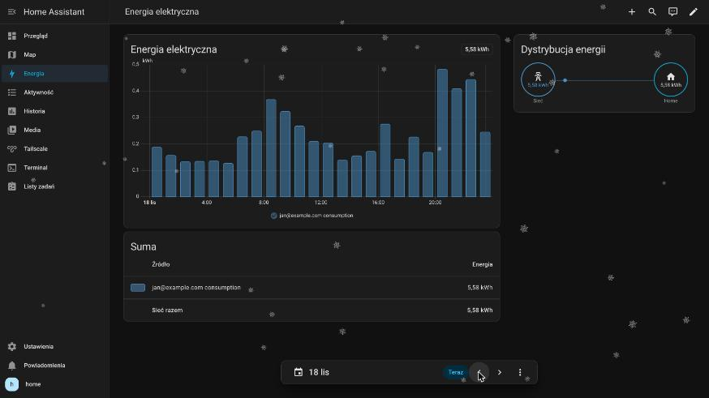
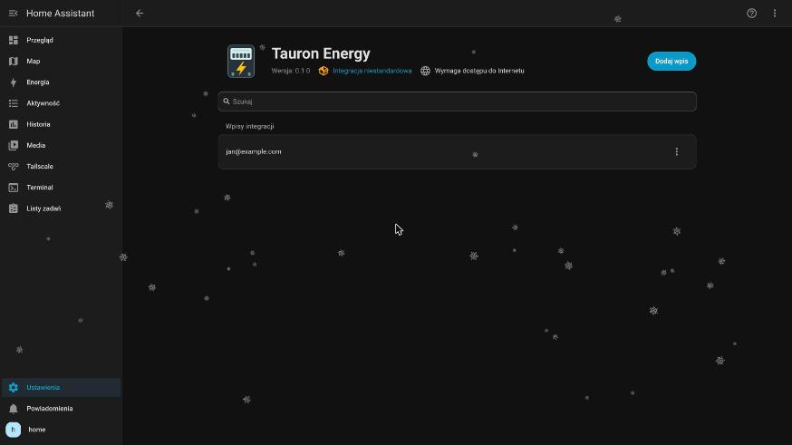
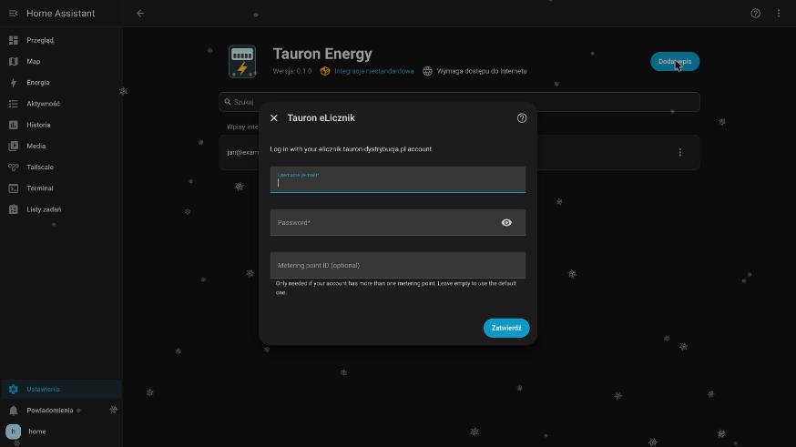
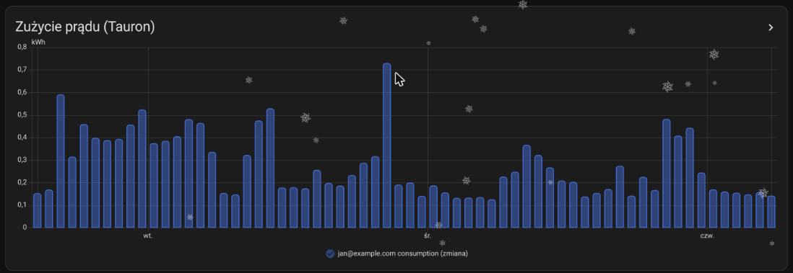

# Tauron Energy for Home Assistant

A minimal custom integration that imports **hourly grid consumption** from
[Tauron eLicznik](https://elicznik.tauron-dystrybucja.pl/) into Home Assistant, so you can
use it in the **Energy dashboard**.

It does one thing: logs in to eLicznik, downloads the hourly consumption CSV and stores it as a
long-term statistic. There are no sensors, no solar/export, no tariff zones.



## Installation

### Using [HACS](https://hacs.xyz/) (recommended)

[](https://my.home-assistant.io/redirect/hacs_repository/?owner=UrbanskiDawid&repository=tauron-elicznik&category=integration)

Click the button above, or add it by hand:

* In HACS open the ⋮ menu → _Custom repositories_
* Add `https://github.com/UrbanskiDawid/tauron-elicznik` with type _Integration_
* Search for "Tauron Energy" and click _Download_
* Restart Home Assistant

HACS not installed yet? Follow the [HACS download guide](https://hacs.xyz/docs/use/download/download/) first.

### Manual

Copy the `custom_components/tauron_energy` directory into your Home Assistant `config/custom_components/` directory:
```bash
cd /config
wget https://github.com/UrbanskiDawid/tauron-elicznik/archive/refs/heads/main.zip
unzip main.zip
mkdir -p custom_components
cp -r tauron-elicznik-main/custom_components/tauron_energy custom_components/
rm -rf main.zip tauron-elicznik-main
```

Then restart Home Assistant.

## Set up

1. Settings → Devices & services → Add integration → **Tauron Energy**.

   

2. Enter your eLicznik e-mail and password. Leave *Metering point ID* empty unless your account
   has several metering points.

   

3. The first import loads the last 30 days (takes a few seconds).
4. Settings → Dashboards → Energy → *Electricity grid* → *Add consumption* → pick
   **`<your account> consumption`** (statistic `tauron_energy:<account>_consumption`).

   

You can check the imported data under Developer tools → Statistics.

### Optional: dashboard card

To show hourly usage on any dashboard, add a *Statistics graph* card:

```yaml
type: statistics-graph
title: Zużycie prądu (Tauron)
entities:
  - tauron_energy:<account>_consumption
stat_types:
  - change
chart_type: bar
period: hour
days_to_show: 3
```



The integration icon (`brand/icon.png`) is shown by Home Assistant 2026.3 or newer.

## Troubleshooting

```yaml
logger:
  logs:
    custom_components.tauron_energy: debug
```

- *Invalid username or password*: check you can log in at elicznik.tauron-dystrybucja.pl.
- *Too many login attempts*: Tauron temporarily blocks logins; the integration retries hourly.

## Related projects

**Tauron eLicznik in Home Assistant**
- [PiotrMachowski/Home-Assistant-custom-components-Tauron-AMIplus](https://github.com/PiotrMachowski/Home-Assistant-custom-components-Tauron-AMIplus) – full-featured eLicznik integration (sensors, generation, tariffs, statistics). Use it if you need more than consumption.
- [staszekj/eltrue-tauron-elicznik-ha](https://github.com/staszekj/eltrue-tauron-elicznik-ha) – another eLicznik meter readings integration.

**Other Tauron integrations for Home Assistant**
- [direk/tauronizer](https://github.com/direk/tauronizer) – Tauron tariff comparison.
- [kubukoz/ha-tauron-g13](https://github.com/kubukoz/ha-tauron-g13) – current G13 tariff zone.
- [elmystico/ha-pl-energy-tariff](https://github.com/elmystico/ha-pl-energy-tariff) – hourly gross electricity prices for Polish G tariffs.
- [twiktorowicz/Pstryk-OSD-Compare](https://github.com/twiktorowicz/Pstryk-OSD-Compare) – compare Pstryk meter data with distribution operator statistics.
- [l4red0/tauron_awarie](https://github.com/l4red0/tauron_awarie), [Eales/tauron-dystrybucja](https://github.com/Eales/tauron-dystrybucja) – planned and unplanned power outages.

**Libraries and APIs**
- [mlesniew/elicznik](https://github.com/mlesniew/elicznik) – Python module and CLI for eLicznik readings.
- [DamianSowinski/tauron-api](https://github.com/DamianSowinski/tauron-api) – PHP JSON API over eLicznik (2021, uses the old login flow).

## Development

```
python3 -m venv .venv && .venv/bin/pip install pytest-homeassistant-custom-component
.venv/bin/python -m pytest
```

Unofficial; not affiliated with TAURON. Uses the same endpoints as the eLicznik website.
